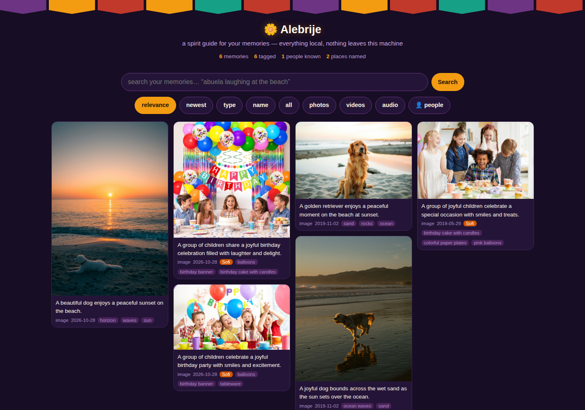
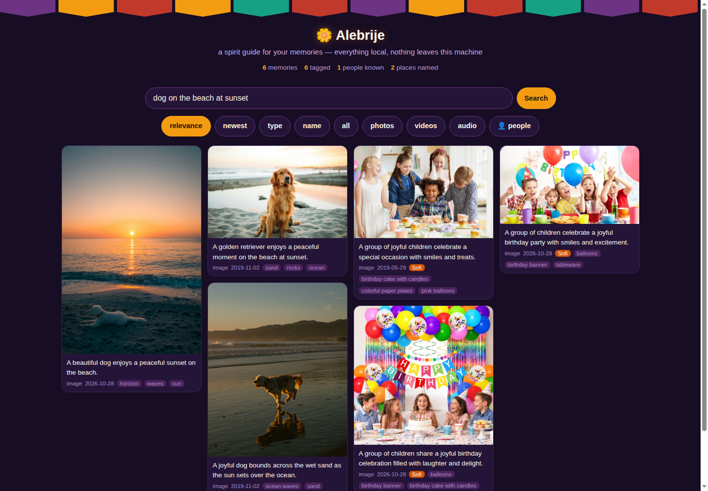
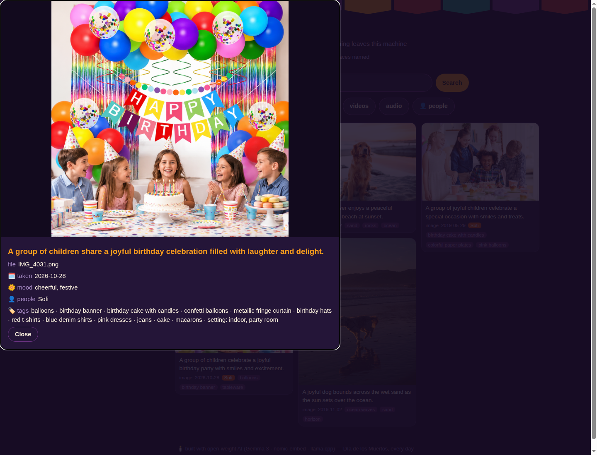
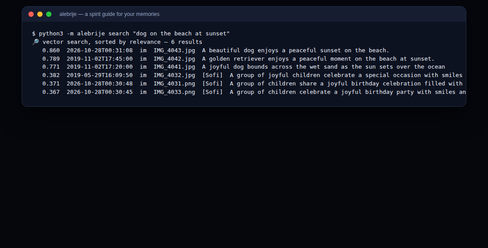

# 🌼 Alebrije

**A spirit guide for your memories.** Alebrijes are the bright, impossible
creatures of Mexican folk art that help souls find their way. This one
helps *you* find your way through a messy archive of photos, videos, and
audio clips — using open-weight AI that runs entirely on your own machine.

Alebrije was built for Día de los Muertos energy: the people we love stay
with us as long as their stories are told. A hard drive full of files named
`IMG_4031.jpg` is a room full of ancestors waiting to be introduced.

## What it does

1. **Introduce your people.** Show Alebrije a sample photo and tell it who's
   who (`alebrije person add Abuela --photo abuela.jpg`). It embeds the face
   locally (SCRFD detection + AdaFace recognition, two small open ONNX
   models) and describes it with the vision model — a private *people book*
   built entirely on your own machine, never from some cloud face database.
2. **It tags every memory.** The open-weight Gemma 3 vision model captions
   each photo and video keyframe: objects, clothing, animals, food, the
   mood of the moment — and a *description* of every person present
   (described, never named by the model itself).
3. **It learns faces, locally.** Every photo (and video keyframe) is also
   scanned for faces; each becomes a 512-d embedding — numbers that mean
   nothing outside this machine's database. Faces close to someone in your
   people book are matched automatically; borderline ones are
   double-checked by Gemma; recurring strangers cluster into "Unnamed"
   people you can name with one rename.
4. **It knows the places.** If your photos carry GPS coordinates, Alebrije
   finds the *closest point of interest* (a park, museum, landmark) via the
   OpenStreetMap Overpass API and always appends the municipality chain —
   `Civic Center Park — Denver, Colorado, USA`.
5. **Ask in plain language.** Everything is embedded with the open
   nomic-embed-text model into a local SQLite index, so you can search
   *"abuela laughing at the beach"* or *"the dog in a costume"* and sort by
   relevance, date, media type, or name.
6. **See it anywhere.** A local web server — marigold-and-papel-picado
   themed — serves the whole collection to any phone or laptop on your
   network. Nothing leaves your machine.

## Screenshots

| | |
|---|---|
|  |  |
|  |  |

## Quick start

Alebrije is a single Python package (3.10+) with just two pip
dependencies (`onnxruntime`, `Pillow`) plus
[llama.cpp](https://github.com/ggml-org/llama.cpp), which **it installs
for you** along with the open-weight models.

**Install it as a real command** (recommended — needs [pipx](https://pipx.pypa.io/)):

```bash
pipx install git+https://github.com/JamesDBartlett3/Alebrije.git@v0.2.0
alebrije setup                   # downloads llama.cpp + models, auto-detects your GPU
alebrije init ~/Pictures/family  # (Windows: use %USERPROFILE%\Pictures)
alebrije up                      # starts the local model servers
alebrije scan                    # index files, read EXIF dates + GPS
alebrije tag                     # vision-tag everything (CPU ~1 min/photo, GPU: seconds)
alebrije serve                   # open http://localhost:8799 — also on your LAN
```

Later: `alebrije update` checks GitHub releases, compares against your
installed version, and upgrades in place (`--check` to just look).
Upgrades pin to tagged releases, never a moving branch.

**Or run it straight from a clone** with no pipx at all — `python alebrije.py`
works from anywhere and is the friendly option on Windows:

```bash
git clone https://github.com/JamesDBartlett3/Alebrije.git && cd Alebrije
python alebrije.py setup
python alebrije.py init ~/Pictures/family
# …same commands as above, with `python alebrije.py` in front
```

Everything lives in `~/.alebrije` (config, database, downloaded models).
Your media is only ever read, never moved or modified.

## Fully self-installing

- `alebrije setup` detects your OS (Linux/macOS/Windows), CPU architecture,
  and **GPU/NPU hardware** — NVIDIA via `nvidia-smi`, AMD ROCm via
  `rocm-smi`, Vulkan via `vulkaninfo`, Apple Metal on any Mac — then
  downloads the matching prebuilt llama.cpp from the official GitHub
  releases. No compiler, no package manager, no keys.
- The five open models download at setup time with resume support: Gemma 3
  4B (vision) and its multimodal projector, nomic-embed-text, plus the two
  face models — SCRFD-10GF (detection) and AdaFace ir101 (recognition) —
  from the adaface-onnx GitHub release.
- When a GPU is present, `alebrije up` launches the models with full layer
  offload (`-ngl 999`); otherwise it uses CPU threads.

## Commands

| command | what it does |
|---|---|
| `setup` | install llama.cpp + models (auto GPU detection) |
| `init <dir>` | point Alebrije at your archive |
| `up` / `stop` | start / stop the local model servers |
| `scan` | index the directory; read EXIF capture dates and GPS |
| `places` | reverse-geocode any GPS-tagged media (Overpass + Nominatim) |
| `tag` | vision-tag untagged media; embed into the search index; find faces |
| `faces` | (re)detect + embed faces, match people, cluster strangers |
| `person add <Name> --photo ` | introduce someone from a sample photo |
| `person list` / `person rename` | tend the people book |
| `name` | match people-book names across the archive |
| `search "<query>" --sort relevance\|date\|type\|name` | plain-language search |
| `serve` | web UI on your LAN (default port 8799) |
| `doctor` | check every piece of the machine |
| `update` | check GitHub releases; upgrade (pipx) if a newer tag exists |
| `selftest` | run the offline test suite |

## People matching, honestly explained

Identity comes from face embeddings, not guesswork. Two small open ONNX
models do the heavy lifting: **SCRFD-10GF** finds faces (and five
landmarks each) — running both a letterboxed whole-image pass and, on
large photos, overlapping native-resolution tiles so small faces in big
group shots are never lost; **AdaFace ir101** turns each aligned face
crop into a 512-d vector. You attach a name once (`alebrije person add
Abuela --photo abuela.jpg` stores the face embedding plus a Gemma
description like "older woman, white braid, jade earrings").

Matching then happens in three bands, all local:

1. cosine ≥ **0.50** against a person's face centroid → matched silently;
2. between **0.36** and 0.50 → the face crop is shown to Gemma alongside
   the person's description for a yes/no double-check;
3. below **0.36** → no match.

Unclaimed faces that resemble each other cluster into `Unnamed #N`
people, so a recurring stranger becomes one rename away from a name.
Every tag stays reviewable in the web UI; renaming someone once updates
the book. The vector math is measured, not vibes: in our smoke tests,
cross-decade photos of the same person scored 0.56–0.95 while different
people scored ≈ 0.0.

## Privacy

Your photos are the last data you'd hand a stranger. Alebrije's model
servers bind to `127.0.0.1`; the web UI reads media files only from
inside the archive directory and serves them on your LAN only. Face
recognition runs entirely on your machine via onnxruntime: the only
thing stored is a 512-d vector per face in your local SQLite database —
just numbers, meaningless outside it, and never sent anywhere. The only
outbound calls are the two open-data geocoding services (OpenStreetMap
Nominatim and Overpass), which receive coordinates, never images — and
only for files that already carry GPS. `alebrije faces purge` deletes
every stored face vector, on demand.

## Testing

```bash
python3 -m unittest discover -t . -s alebrije/tests   # or:
python alebrije.py selftest
```

146 offline tests cover the scanner (including a hand-built EXIF+GPS JPEG),
the face pipeline (letterbox/tiling math, SCRFD decoding, alignment,
threshold bands, clustering, migration from v0.1 databases), tag parsing,
people matching, vector math, search sorting, the bootstrap asset picker,
server lifecycle, the web API (real HTTP on an ephemeral port), and the
CLI — all with fake model servers and fake face models, no network, no GPU.
The face models themselves were smoke-tested against public-domain
portraits of the same people decades apart (matched) and different people
(did not).

## License

MIT. Gemma 3 is gated under Google's Gemma license; nomic-embed-text is
Apache-2.0; llama.cpp is MIT. The face models come from the open
research ecosystem: SCRFD-10GF and AdaFace ir101 weights are released by
the InsightFace and AdaFace projects for research use (the converters'
code is MIT) — the same research-license footing as most open face
models, documented here so you can decide for yourself. All weights
download from their official repositories at setup time.
